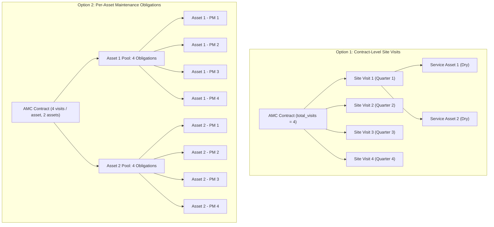
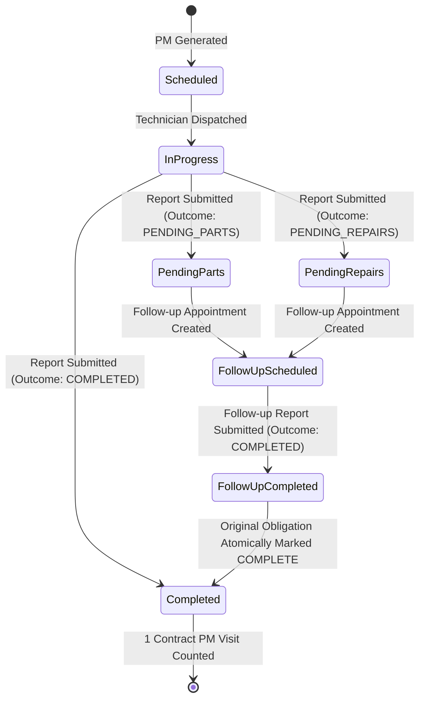

# PYS Phase 1 — AMC Business-Rule Decisions Record

**Document Date:** 14 October 2026  
**Phase:** Phase 1 — Evidence Collection, Data-Integrity Baseline & Business-Rule Decisions  
**Status:** Canonical Decision Specification & Analysis  
**Classification:** Approved Documentation Baselines vs. Pending Business Decisions

---

## 1. Executive Context & Architectural Scope

In Place Your Service (PYS), the Annual Maintenance Contract (AMC) engine manages commercial agreements, planned preventive maintenance (PM) scheduling, service-type distribution (Dry, Jet, Pumpdown), and contract lifecycle tracking (Renewals, Cancellations, Asset Coverage).

Auditing of the codebase and live Supabase production database revealed a severe semantic contradiction at the core of the engine:
1. **The application code generates maintenance schedules per asset per cadence date** (`dates x assets`).
2. **The contract entity records a single scalar integer** `total_visits` (e.g., `4`).
3. **The contract progress calculation compares completed asset schedules directly against contract total visits** (`remainingVisits = max(0, total_visits - completedSchedules)`).
4. **The service allocation planner introduces specific counts** (`dry_service_visits`, `jet_service_visits`, `pumpdown_service_visits`) that do not reconcile with multiple assets.

This document systematically resolves these business rules, proves where existing documentation is silent, formalizes the pending business decision without fabricating unapproved business choices, and outlines the concrete consequences of both potential models.

---

## 2. Core Semantic Question: Meaning of Included Visits

### `BUSINESS DECISION REQUIRED`

**The core question that the business must formally decide:**
> Does `total_visits` on an AMC contract represent:
> - **Option 1: Contract-Level Site Visits** (the technician visits the customer's site `N` times during the contract year, servicing all covered AC assets during that visit)? OR
> - **Option 2: Per-Asset Maintenance Obligations** (each covered AC asset is independently entitled to `N` maintenance services during the contract year, totaling `N x num_assets` service events)?

---

### 2.1 Exhaustive Documentation Audit

A forensic review of all existing project documentation reveals that **the documentation does NOT settle this decision**:

1. **`DOCS/PRD.md` (Product Requirements Document, Section 4):**
   - States: *"AMC is a contract entity, not merely a boolean customer flag. Track: AMC ID, Customer, Plan, Start/end dates, Frequency, Amount, Number of visits, Status, Renewal information, Included assets, Notes."*
   - Mentions "Number of visits" and "Included assets", but never defines whether the visit count multiplies across assets.
2. **`DOCS/TRD.md` (Technical Requirements Document, Section 10):**
   - Inputs to PM generation: Start Date, End Date, Frequency, Included AC Assets.
   - Algorithm: Generates dates from calendar math within contract boundaries. For each covered asset, inserts scheduled obligations.
   - Does NOT reference `total_visits` in the generation algorithm.
3. **`DOCS/RULES.md` (Business Rules, Section 6 & 7):**
   - Section 6 defines contract fields: customer, dates, plan/frequency, amount, included assets, status.
   - Section 7 specifies algorithm invariants: generates dates via calendar math; inserts `(amc_id, asset_id, scheduled_date)` using `ON CONFLICT DO NOTHING`.
   - Silent on how `total_visits` reconciles with multiple covered assets.
4. **`DOCS/POLICY.md` (Operational Policies, Section 5):**
   - States: *"Contract amounts, included visits, and valid periods are immutable once activated except through controlled operational edits."*
   - Does not clarify per-asset versus contract-level semantics.
5. **Database Migrations (`20261007000000_foundation_schema.sql`):**
   - `amc_contracts` defines `total_visits INTEGER NOT NULL CHECK (total_visits > 0)`.
   - `service_schedules` defines `amc_id UUID`, `asset_id UUID`, `scheduled_date DATE`, `visit_number INTEGER`.
   - Neither schema defines a separate `contract_visit_number` versus `asset_visit_number`.
6. **Observed Live Production Data:**
   - Contract `AMC-2026-0003` has `total_visits = 4` and covers 2 assets (`ESSC-0001` and `ESSC-0002`).
   - Generation produced **8 schedules** (4 dates x 2 assets).
   - In code (`amc.service.ts:502`), remaining visits is computed as `Math.max(0, row.total_visits - scheduleStats.completed)`.
   - If a technician performs 1 site visit and services both assets, `completed` becomes 2, cutting the contract balance in half immediately. If both assets are serviced twice, `completed` becomes 4, and the contract shows **0 remaining visits (100% completed)** despite only half the contractual cadence being fulfilled!

**Conclusion:** The existing documentation is genuinely underspecified. Phase 1 must not invent an arbitrary choice. The options and their concrete implications are detailed below.

---

### 2.2 Deep Comparative Analysis: Option 1 vs. Option 2

---

### 2.3 Detailed Seven-Dimension Comparison Matrix

| Evaluation Dimension | Option 1: Contract-Level Site Visits (Visit = Site Appointment) | Option 2: Per-Asset Included Obligations (Visit = AC Service Unit) |
|---|---|---|
| **1. Commercial Pricing & Contract Total** | Contract defines `total_visits = 4` site visits. Pricing is contract-based or base-fee + per-unit surcharge. Commercial customer understands: *"We will visit your facility 4 times per year."* | Contract defines `4 visits per asset`. For 5 assets, total purchased obligations = 20. Pricing is typically `rate_per_asset x 4 x num_assets`. Customer understands: *"We purchased 20 equipment services."* |
| **2. Generated PM Obligations** | Generates 4 site-level visit events. For each site visit, child obligations are generated for each active covered asset. Total appointment dates = 4. Total equipment services = `4 x num_assets`. | Generates 20 individual asset-service obligations. While they may be grouped onto identical dates by default cadence, they represent separate billable units. |
| **3. Visit Scheduling & Technician Dispatch** | Dispatcher schedules 1 technician appointment for the site. Technician receives 1 work order covering all assigned ACs at that site for that visit date. | Dispatcher schedules individual asset appointments, or multi-asset appointments that deduct from per-asset quotas. |
| **4. Asset Coverage Changes (Mid-Term Add/Remove)** | Adding an AC mid-contract adds that AC to future remaining site visits (e.g., 2 remaining visits). Contract total visits remains 4. Removing an AC stops future servicing on that AC. | Adding an AC requires defining its obligation quota (pro-rated, e.g., 2 visits). Total contract obligations increase. Removing an AC creates orphaned obligation balances that must be credited or expired. |
| **5. Completion Metrics & Balances** | 1 site visit completed (all covered assets serviced) = 1 contract visit completed. Contract balance = `total_visits (4) - completed_site_visits (1) = 3 remaining (25% complete)`. Clean, intuitive for commercial customers. | 1 asset serviced = 1 obligation completed. If 5 assets serviced on visit 1, completion = `5 / 20 = 25% complete`. If 1 asset is skipped, completion = `4 / 20 = 20%`. Allows granular partial completion. |
| **6. Renewal & Successor Contracts** | Successor contract inherits 4 site visits. Simple carry-forward. Predecessor history shows: 4 scheduled visits, 4 completed visits. | Successor contract defines `N visits per asset` for active asset inventory. Unused asset obligations require explicit expiration or rollover policy. |
| **7. Historical Reports & Balances** | Service report is issued for the site appointment covering `N` assets. Report outcomes roll up cleanly to the visit. | Service report tracks per-asset service credits. Partial visits cleanly documented per asset. |

---

### 2.4 Architect's Recommendation

> [!TIP]
> **Architectural Recommendation (Pending Business Approval): Option 1 (Contract-Level Site Visits with Asset Breakdown).**
>
> **Rationale:**
> In Indian HVAC operational practice and residential/commercial facility maintenance, an AMC agreement is universally sold as: *"Quarterly AMC: 4 preventive maintenance visits per year to inspect all your ACs."*
>
> **Recommended Data Model Implementation:**
> 1. `amc_contracts.total_visits` = Number of planned **site maintenance visits** (e.g., 4).
> 2. `dry_service_visits + jet_service_visits + pumpdown_service_visits = total_visits` (e.g., 2 Dry + 2 Jet + 0 Pumpdown = 4 visits).
> 3. Each site maintenance visit has a planned service type that applies to all covered assets serviced during that visit (or allows per-asset override during execution).
> 4. `service_schedules` records the site visit with child records or links to each covered asset.
> 5. Contract progress is measured in **Site Visits Completed / Total Contract Visits**, preventing the multiplier bug where servicing 2 assets in 1 visit consumes 2 visits.

*Note: This recommendation is strictly a proposal for executive stakeholder approval and is NOT enacted in code during Phase 1.*

---

## 3. Service Allocation Invariants

### 3.1 The Fundamental Allocation Equation

The AMC allocation planner introduced in migration `20261011010000` defines three service types:
- **Dry Service:** Filter cleaning, coil inspection, electrical check, general blower dusting.
- **Jet Service:** High-pressure water pump cleaning of indoor/outdoor cooling coils and drain tray flushing.
- **Pumpdown Service:** Comprehensive system pumpdown, refrigerant recovery/pressure testing, compressor acid check, and deep overhaul.

**The Intended Core Invariant:**
$$\text{dry\_service\_visits} + \text{jet\_service\_visits} + \text{pumpdown\_service\_visits} = \text{total\_visits}$$

### 3.2 Formal Validation Rules to be Enforced in Phase 3

1. **Non-Negative Value Rule:**
   `dry_service_visits >= 0 AND jet_service_visits >= 0 AND pumpdown_service_visits >= 0`
   *(Currently enforced by live database check constraints).*
2. **Sum-Equals-Total Invariant:**
   `dry_service_visits + jet_service_visits + pumpdown_service_visits = total_visits`
   *(Currently ABSENT from database check constraints and absent from partial PATCH API validator).*
3. **Legacy Contract Handling (Null Allocations):**
   - For contracts created prior to the allocation planner where all three fields are NULL (5 contracts in production: `AMC-2026-0001`, `0002`, `0003`, `0005`, `0007`):
   - **RULE:** The application must NOT fabricate numbers or silently rewrite history.
   - Legacy contracts must be displayed as `Allocation: Unallocated (Legacy)` or `Default Alternate`.
   - Any operational edit (PATCH) that modifies an unallocated contract must be required to provide a complete, balanced allocation set before saving.
4. **No Silent Fallback Generator:**
   - The current code at `amc.service.ts:119-122` silently inserts `DRY_SERVICE` if generation runs out of allocated types.
   - **RULE:** If the contract dates exceed the allocation sum or vice-versa, generation must fail with a validation error (`CADENCE_ALLOCATION_MISMATCH`), rather than silently inventing extra Dry services.

---

## 4. AMC Renewal Semantics

Renewal creates a new contractual commitment covering a subsequent time period while preserving historical records.

### 4.1 Invariants for Successor Contracts
1. **Predecessor Immutability:**
   - The predecessor contract status is updated to `RENEWED`.
   - Its start date, end date, total visits, allocations, covered assets, and generated schedule history are **PERMANENTLY FROZEN**.
   - No renewal action may modify, re-link, or delete predecessor records.
2. **Explicit Allocation Carry-Forward or Re-Configuration:**
   - **Defect PYS-003 Remediation:** Currently, `renewContract` drops allocations to NULL.
   - **RULE:** The renewal API must accept an explicit allocation payload (`dryServiceVisits`, `jetServiceVisits`, `pumpdownServiceVisits`).
   - If the renewal payload omits allocations, it must either:
     - Automatically copy the predecessor's valid allocation; OR
     - Require explicit allocation input before allowing renewal activation.
3. **Asset Coverage Snapshotting:**
   - Covered assets from the predecessor contract are cloned to the successor contract (`amc_assets`).
   - Assets deactivated prior to the renewal date must be excluded from the successor contract.
4. **Maintenance Obligation Isolation:**
   - The successor contract starts with `completedVisitsCount = 0`.
   - New schedules are generated with new schedule numbers, strictly within the successor's date range.
   - Incomplete visits from the predecessor do NOT roll over unless explicitly configured under a future commercial rollover policy.

---

## 5. Follow-Ups, Retries, and PM Completion

### 5.1 Distinction: PM Visit vs. Follow-Up Appointment

| Event Type | Purpose | Consumes Included PM Visit? | Triggers Contract Completion? |
|---|---|---|---|
| **Primary PM Visit** | Scheduled contractual preventive maintenance inspection. | **YES** (1 planned visit consumed). | **YES**, if primary outcome is `COMPLETED`. |
| **Follow-Up Revisit (Pending Parts)** | Revisit to install ordered parts or replacement components. | **NO.** Revisit is a corrective continuation of the primary PM. | **NO.** Does not count as an additional visit. |
| **Follow-Up Revisit (Pending Repairs)** | Revisit to complete heavy coil brazing, leak repair, or off-site overhaul. | **NO.** Corrective continuation. | **NO.** Does not count as an additional visit. |
| **Customer Missed / Reschedule** | Customer not available on scheduled date; appointment rescheduled. | **NO.** The unfulfilled appointment is replaced. | **NO.** |

### 5.2 Authoritative Obligation Completion Workflow

**Completion Rules:**
1. A primary schedule with outcome `PENDING_PARTS` or `PENDING_REPAIRS` remains `PENDING` (contract visit count is NOT incremented).
2. Creating a follow-up schedule (`rescheduled_from_id = original_schedule_id`) does NOT increase contract `total_visits` or `schedulesCount`.
3. When the follow-up report is submitted with outcome `COMPLETED`, the resolving report marks the originating issue `RESOLVED`.
4. **Atomic Invariant:** Upon resolution of the follow-up report, the originating PM obligation transitions to `COMPLETED`, incrementing the contract's completed visit count by exactly **1**.

---

## 6. Comprehensive Decision Register

| Decision Area | Status | Documented Baseline / Rule | Pending Business Clarification |
|---|---|---|---|
| **Included Visits Cardinality** | `BUSINESS DECISION REQUIRED` | None in PRD/TRD. Generator uses `dates x assets`; progress calculation uses contract total. | Formally approve Option 1 (Site Visits) vs Option 2 (Per-Asset Units). |
| **Allocation Invariant** | **APPROVED RULE** | `Dry + Jet + Pumpdown = total_visits`. Must be enforced via DB check constraint. | None. |
| **Cadence vs Total Visits Mismatch** | **APPROVED RULE** | Total visits must match calendar dates (e.g., Quarterly = 4 dates). If mismatch occurs, generator rejects with 400. | None. |
| **Legacy Contract Allocations** | **APPROVED RULE** | 5 legacy contracts in production remain NULL until edited. No fake numbers backfilled. | None. |
| **Renewal Allocation Loss** | **APPROVED RULE** | Successor contracts must preserve predecessor allocations or require explicit input. | None. |
| **Follow-Up Visit Accounting** | **APPROVED RULE** | Follow-up appointments never consume contract PM visit balance. | None. |
| **Removed Asset History** | **APPROVED RULE** | Removing covered assets must soft-deactivate coverage (`end_date`), not DELETE row. | None. |
