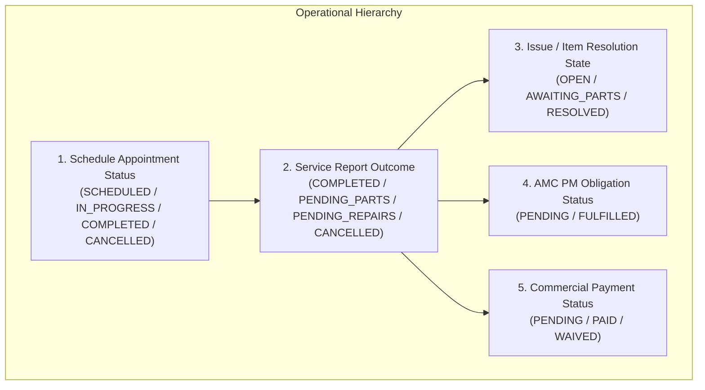
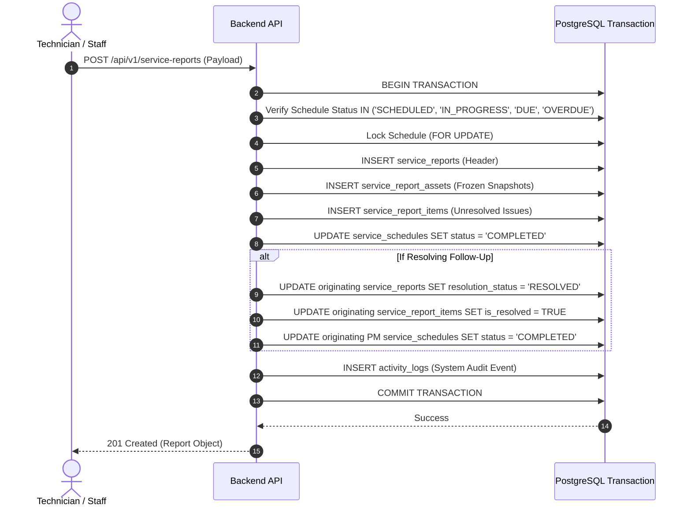

# PYS Phase 1 — Service-Report History & Issue-Resolution Policy

**Document Date:** 14 October 2026  
**Phase:** Phase 1 — Evidence Collection, Data-Integrity Baseline & Business-Rule Decisions  
**Status:** Canonical Policy Specification  
**Classification:** Operational Governance & Engineering Integrity Standard

---

## 1. Executive Summary & Policy Scope

Service reports serve as legal, commercial, and operational records of work performed on customer air-conditioning equipment. In Place Your Service (PYS), reports capture technician observations, refrigerant handling, parts recommendations, customer sign-offs, and equipment snapshots.

Auditing revealed critical defects in report handling:
- **Historical Snapshot Mutation (PYS-007):** Updating a report deletes and re-creates snapshots from current `ac_assets` records, retroactively altering issued historical records.
- **GET Mutation Bug (PYS-007):** Querying a report via `GET /api/v1/service-reports/:id` executes an `UPDATE` statement if a linked follow-up is cancelled.
- **Over-Broad Issue Resolution (PYS-006 & PYS-009):** A follow-up report resolves an entire originating report and all attached items, even for multi-asset visits where only one asset was serviced.
- **Race-Prone Issuance & Cancelled Schedule Reporting (PYS-008):** Missing database uniqueness constraints allow concurrent duplicate reports and permit report creation against cancelled schedules.

This document establishes the binding policy for report immutability, issue resolution, multi-asset scoping, and correction management to guide Phase 3 and Phase 5 remediation.

---

## 2. Core Entities and State Separation

To eliminate ambiguity across operational workflows, the system strictly separates five distinct concepts:



### Definitional Boundaries

| State Concept | Database Entity | Permitted Values | Definition & Scope |
|---|---|---|---|
| **1. Schedule Status** | `service_schedules.status` | `SCHEDULED`, `DUE`, `OVERDUE`, `IN_PROGRESS`, `COMPLETED`, `CANCELLED`, `RESCHEDULED` | Tracks the physical logistics of whether a technician was dispatched and arrived at the customer site. |
| **2. Report Outcome** | `service_reports.primary_outcome` | `COMPLETED`, `PENDING_PARTS`, `PENDING_REPAIRS`, `ACCESS_DENIED`, `CANCELLED` | Captures what the technician achieved during that specific visit event. |
| **3. Issue Resolution State** | `service_report_items.is_resolved` & `service_reports.resolution_status` | Items: `boolean`<br>Reports: `OPEN`, `AWAITING_PARTS`, `AWAITING_REPAIR`, `RESOLVED`, `CANCELLED` | Tracks whether a specific mechanical fault, leak, or part replacement has been definitively remedied. |
| **4. PM Obligation Status** | Contract progress counter | `PENDING`, `FULFILLED` | Determines whether a contractual maintenance obligation owed to the customer has been satisfied. |
| **5. Payment Status** | `payments.status` | `PENDING`, `PARTIAL`, `COMPLETED`, `REFUNDED` | Commercial accounting of customer payment for chargeable services or parts. |

---

## 3. Ten Mandatory Tenets of Report Lifecycle

### Tenet 1: The Original Report Is an Immutable Historical Record
The original service report captures the state of the equipment and the work performed *at the exact time of the visit*. Once submitted and issued, the report's text, observations, outcomes, technician remarks, customer feedback, and equipment snapshots are **PERMANENTLY FROZEN**.

### Tenet 2: Subsequent Visits Must Create Distinct New Reports
When a technician revisits a site to complete pending repairs or install parts, the technician does NOT edit the previous report. The revisit appointment must generate a **new, independent service report** with its own report number, service date, technician ID, and snapshot.

### Tenet 3: Issues Resolve Only When Work Is Verified Complete
An originating issue (e.g., gas leak, blower motor replacement) remains `OPEN` or `AWAITING_*` until a resolving report is submitted with verifiable completion evidence for that specific issue.

### Tenet 4: Explicit Bidirectional Resolution Linkage
Resolution must link the exact resolving report to the originating issue:
- `service_reports.resolving_report_id`: Points to the successor report that closed the issue.
- `service_reports.originating_report_id`: Points to the predecessor report where the fault was identified.
- `service_reports.resolved_at`: Accurate timestamp when the resolution was verified.

### Tenet 5: Multi-Asset Isolation
In a report covering multiple AC units (e.g., 3 units at a commercial site):
- If Unit A is completed, Unit B requires parts, and Unit C requires coil repair:
- A subsequent visit that resolves Unit B's parts **MUST NOT** mark Unit C as resolved.
- Issue resolution must be enforced at the **item and asset level** (`service_report_items.asset_id`), not solely at the report header level.

### Tenet 6: Idempotent and Non-Duplicating Processing
Repeated execution of resolution workflows, automated reconciliation scripts, or batch synchronizations must be idempotent. A resolving event must never create duplicate completion events or duplicate links.

### Tenet 7: Cancellation Never Implies Resolution
If a follow-up appointment is cancelled, the underlying equipment issue does **NOT** become resolved. It remains `AWAITING_PARTS` or `AWAITING_REPAIR` and must return to the unscheduled follow-up dispatch queue.

### Tenet 8: Payment-Pending Work Must Not Be Prematurely Closed
If service completion requires customer payment, the operational resolution state must not bypass commercial verification. Payment-pending work remains flagged until payment confirmation or administrative sign-off.

### Tenet 9: Documented Correction and Amendment Ledger
If an issued report contains a clerical or diagnostic error, corrections must NOT overwrite the historical record. Corrections must use an **append-only amendment audit ledger** documenting the corrected field, original value, new value, authorizing staff member, reason, and timestamp.

### Tenet 10: Read Operations Are Strictly Free of Side Effects
Reading a service report (e.g., `GET /api/v1/service-reports/:id`) must be **strictly read-only**. No database `UPDATE`, state transition, or clearing of links may ever execute during a read query.

---

## 4. Multi-Asset Scoping & Per-Item Tracking

### 4.1 Defect Analysis: Live Production Inspection
Live database inspection revealed that the single historical report item in production:
- Item ID: `9dc3c7be-b415-4428-83f7-afde841ac246`
- Description: "Required to be leak tesing & Gas charging"
- Attached to Report: `123`
- `asset_id`: **`NULL`**

Because `asset_id` was NULL, migration `20261011010000` marked the item resolved using an all-encompassing report join. In a multi-asset scenario, this would have closed all items across all assets simultaneously.

### 4.2 Target Multi-Asset Resolution Model

```text
Service Report #101 (Multi-Asset Site Visit)
├── Asset 1 (Split AC - Living Room) -> Outcome: COMPLETED
├── Asset 2 (Cassette AC - Master Bed) -> Outcome: PENDING_PARTS
│   └── Item #1: Expansion Valve (asset_id: Asset 2) -> is_resolved: FALSE
└── Asset 3 (Window AC - Guest Room) -> Outcome: PENDING_REPAIRS
    └── Item #2: Fan Motor Overhaul (asset_id: Asset 3) -> is_resolved: FALSE

Follow-Up Visit #102 (Target Scope: Asset 2 Only)
└── Resolves: Item #1 ONLY
    ├── Asset 2 Item #1 -> is_resolved: TRUE
    └── Asset 3 Item #2 -> REMAINS is_resolved: FALSE (Still Pending!)
```

### Remediation Requirements for Phase 5:
1. **Mandatory Foreign Key:** `service_report_items.asset_id` must be required for all equipment-specific diagnostic and parts items.
2. **Follow-Up Scope Preservation:** When creating a follow-up schedule, the system must persist the specific list of `target_asset_ids` and `target_item_ids`, rather than defaulting to `report.assets[0]`.
3. **Resolution Validation:** When the follow-up report is submitted, the backend validator verifies that only items matching the follow-up scope are marked `is_resolved = true`.

---

## 5. Report Correction and Amendment Policy

To preserve evidentiary standards and audit reliability, historical reports adhere to the following amendment policy:

### 5.1 Permitted Operational Corrections
Within 24 hours of issuance, authorized Staff or Admins may amend:
- Clerical typos in technician remarks or observations.
- Customer representative name or contact phone.
- Item part numbers if miscatalogued.

### 5.2 Strictly Prohibited In-Place Edits
The following fields may **NEVER** be updated in place once submitted:
- Equipment snapshot values (`asset_tag`, `brand`, `model_number`, `serial_number`, `capacity_tons`).
- Date and time of service (`service_date`, `start_time`, `end_time`).
- Primary outcome (`primary_outcome`).
- Customer signature URL.

### 5.3 Amendment Ledger Structure
All amendments will be stored in an append-only `service_report_amendments` table:
```sql
-- Target design for Phase 3/5 schema
CREATE TABLE IF NOT EXISTS service_report_amendments (
  id UUID PRIMARY KEY DEFAULT gen_random_uuid(),
  report_id UUID NOT NULL REFERENCES service_reports(id),
  field_name TEXT NOT NULL,
  old_value TEXT,
  new_value TEXT NOT NULL,
  reason TEXT NOT NULL,
  amended_by UUID NOT NULL REFERENCES profiles(id),
  amended_at TIMESTAMPTZ NOT NULL DEFAULT NOW()
);
```

---

## 6. Atomic State Transitions & Idempotency Invariants

### 6.1 Report Submission Transaction Boundary
The creation of a service report must execute within a **single PostgreSQL transaction** (or RPC function):



### 6.2 Failure Rollback Guarantee
If any child write (snapshot creation, item creation, status update, or audit logging) fails:
- The entire transaction rolls back cleanly.
- Zero orphaned report headers or partial items are persisted.
- The schedule status remains unchanged.
