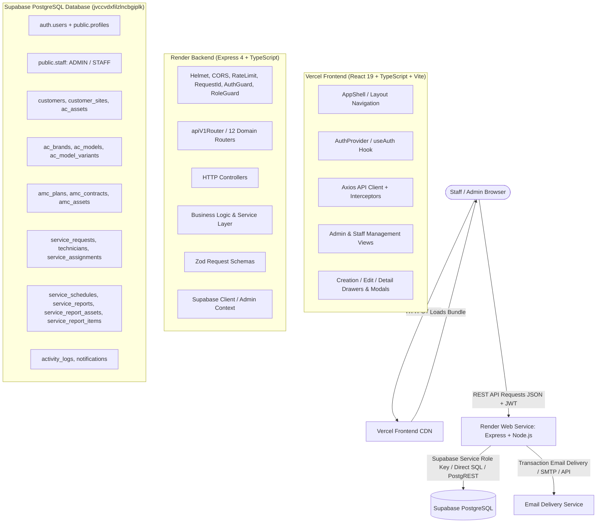
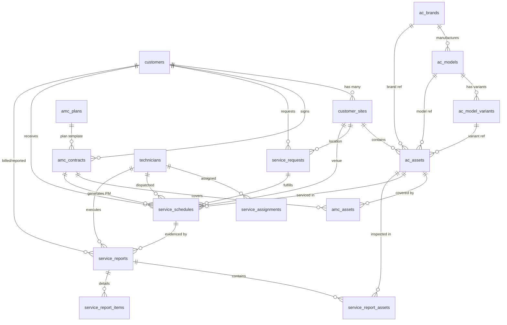

# PYS Architecture Map — Full System Blueprint

**Document Version:** 2.0 (Post-Audit Reconstructed Baseline)  
**Date:** 14 October 2026  
**Repository:** `Aayu061/place-your-service` (`main` @ `7f8cfab`)  
**Target Environments:** Vercel (Frontend) → Render (Backend API) → Supabase PostgreSQL (Database)

---

## 1. System High-Level Topology

> [!IMPORTANT]
> **Strict Architectural Constraint:** The browser client NEVER executes direct writes against Supabase PostgreSQL. All operations pass through the Render Express backend (`/api/v1/*`), which enforces validation, role permissions, transaction consistency, and audit logging.

---

## 2. Frontend Architecture (`src/`)

### 2.1 Entry Point & Authentication Routing
- **Entry Points:** `index.html` → `src/main.tsx` → `src/App.tsx`.
- **State-Based Navigation:** The application uses a central state router in [`src/App.tsx`](file:///c:/Users/aayup/Desktop/PYS/src/App.tsx) inside `<AppShell>` rather than traditional browser history routing.
- **Route Guards & Role Verification:**
  - `AuthProvider` ([`src/context/AuthContext.tsx`](file:///c:/Users/aayup/Desktop/PYS/src/context/AuthContext.tsx)) initializes session via `supabase.auth.getSession()`.
  - Server-verified role is obtained from backend `/api/v1/auth/me`. Roles are strictly `'ADMIN'` or `'STAFF'`.
  - Non-authenticated requests immediately render [`src/pages/Login.tsx`](file:///c:/Users/aayup/Desktop/PYS/src/pages/Login.tsx).
  - Admin-only sections (e.g. `StaffManagement`, `AcMasterManagement`) are restricted by role guards in both navigation bar and page render logic.

### 2.2 Active Operational Modules
1. **Dashboard:** [`src/pages/DashboardShell.tsx`](file:///c:/Users/aayup/Desktop/PYS/src/pages/DashboardShell.tsx) — Real-time operational counters, alerts, recent services, expiring AMCs.
2. **Customers & Sites:** [`src/pages/CustomerManagement.tsx`](file:///c:/Users/aayup/Desktop/PYS/src/pages/CustomerManagement.tsx) — Customer lists, site management, AC asset registration modal with brand/model/variant cascades.
3. **AMC Contracts & Quotations:** [`src/pages/AmcManagement.tsx`](file:///c:/Users/aayup/Desktop/PYS/src/pages/AmcManagement.tsx) — Quotation builder, contract lifecycle, covered assets, PM obligation preview, renewal.
4. **Service Requests:** [`src/pages/ServiceRequestManagement.tsx`](file:///c:/Users/aayup/Desktop/PYS/src/pages/ServiceRequestManagement.tsx) — Breakdown ticketing, priority handling, status lifecycle.
5. **Technicians Master:** [`src/pages/TechnicianManagement.tsx`](file:///c:/Users/aayup/Desktop/PYS/src/pages/TechnicianManagement.tsx) — Operational technician register, skill tags, active assignments.
6. **Service Schedules:** [`src/pages/ServiceScheduleManagement.tsx`](file:///c:/Users/aayup/Desktop/PYS/src/pages/ServiceScheduleManagement.tsx) — Calendar/queue of upcoming visits, technician dispatch, rescheduling.
7. **Service Reports:** [`src/pages/ServiceReportsManagement.tsx`](file:///c:/Users/aayup/Desktop/PYS/src/pages/ServiceReportsManagement.tsx) — Completion register, report inspection, print view, resolution tracking.
8. **AC Master Data:** [`src/pages/AcMasterManagement.tsx`](file:///c:/Users/aayup/Desktop/PYS/src/pages/AcMasterManagement.tsx) — AC Brands, Models, and Variants catalog management.
9. **Staff Management:** [`src/pages/StaffManagement.tsx`](file:///c:/Users/aayup/Desktop/PYS/src/pages/StaffManagement.tsx) — Admin user administration and active staff accounts.

### 2.3 API Client & Error Handling
- **Base Client:** [`src/services/api/apiClient.ts`](file:///c:/Users/aayup/Desktop/PYS/src/services/api/apiClient.ts) using Axios.
- **Base URL Resolution:** `import.meta.env.VITE_API_BASE_URL` with local fallback to `http://localhost:5000`. In production Vercel builds, `VITE_API_BASE_URL` points to `https://place-your-service-api.onrender.com/api/v1`.
- **Request Interceptor:** Injects Supabase access token as `Bearer <token>` and attaches client request headers.
- **Response Interceptor:** Normalizes server API responses:
  - Format: `{ success: boolean, data?: T, error?: { code: string, message: string, details?: any } }`.
  - Dispatches user-friendly toast alerts via `<ToastProvider>`.

---

## 3. Backend Architecture (`server/src/`)

### 3.1 Express Middleware Chain
Implemented in [`server/src/app.ts`](file:///c:/Users/aayup/Desktop/PYS/server/src/app.ts):
1. **Helmet:** Sets security headers (CSP relaxed in development, strict in production).
2. **CORS:** Configurable via `CORS_ORIGIN`. Validates Origin header; permits local dev ports and production Vercel origin.
3. **Body Parsers:** `express.json({ limit: '1mb' })`, `express.urlencoded({ extended: true, limit: '1mb' })`.
4. **Request Correlation ID:** Generates UUID `X-Request-Id` for tracing across logs.
5. **Request Logging:** Winston/Morgan logger capturing HTTP method, route, status code, latency.
6. **Rate Limiting:** `express-rate-limit` (100 req/15 min per IP), bypassing health check paths.
7. **Router Mounting:** Mounted at `/api/v1`.
8. **404 Not Found Handler:** Formats clean JSON error response for unmapped routes.
9. **Central Error Handler:** Formats `AppError` and unhandled exceptions into structured `{ success: false, error: ... }` responses with HTTP status codes.

### 3.2 Route & Controller Layer
Located in `server/src/routes/` and `server/src/controllers/`:
- `health.routes.ts`: Liveness (`/health`) and readiness (`/health/ready`).
- `auth.routes.ts`: Token verification, session exchange, `/auth/me`.
- `staff.routes.ts`: Staff user listing, role mutation, deactivation.
- `customer.routes.ts`: Customers CRUD, site queries, statistics.
- `site.routes.ts`: Customer sites CRUD, primary site assignment.
- `asset.routes.ts`: AC asset register, warranty tracking, ESSC asset tag generation.
- `masterData.routes.ts`: AC Brands, Models, and Variants CRUD with cascading soft-deactivation.
- `serviceRequest.routes.ts`: Service requests lifecycle, priority, assignment.
- `technician.routes.ts`: Technician master data, workload, skill tags.
- `amc.routes.ts`: Quotations, active contracts, PM generation, renewal.
- `schedule.routes.ts`: Planned maintenance visits, assignment, dispatch, cancellation, rescheduling.
- `serviceReport.routes.ts`: Field visit completion reports, asset snapshots, issue resolution.

### 3.3 Authorization & Role Enforcement
- `requireAuth`: Validates Supabase JWT, retrieves `auth.users.id`.
- `requireRole(['ADMIN', 'STAFF'])`: Verifies active record in `public.staff`. Prevents deactivated staff from executing API mutations.
- `requireAdmin`: Restricts sensitive endpoints (staff administration, master data deactivation) to `ADMIN` role only.

---

## 4. Database Architecture (`supabase/migrations/`)

### 4.1 Entity Relationship Diagram

### 4.2 Table Inventory & Role Map

| Table Name | Primary Key | Foreign Keys / Key Relations | Purpose |
| :--- | :--- | :--- | :--- |
| `profiles` | `id` (UUID, auth.users) | None | User profile details (name, email, phone) |
| `staff` | `id` (UUID) | `user_id` → `profiles.id` | Administrative and staff role enforcement (`ADMIN`, `STAFF`) |
| `customers` | `id` (UUID) | None | Customer accounts (Customer code: `CUST-XXXXXX`) |
| `customer_sites` | `id` (UUID) | `customer_id` → `customers.id` | Physical customer branches/sites |
| `ac_brands` | `id` (UUID) | None | HVAC equipment manufacturers |
| `ac_models` | `id` (UUID) | `brand_id` → `ac_brands.id` | Equipment model series & default specs |
| `ac_model_variants` | `id` (UUID) | `model_id` → `ac_models.id` | Specific capacity/tonnage variants |
| `ac_assets` | `id` (UUID) | `site_id`, `brand_id`, `model_id`, `variant_id` | Registered AC units with unique ESSC code (`ESSC-XXXXXX`). Includes warranty dates and breakdown allocations (`total_warranty_services`, `dry_warranty_visits`, `jet_warranty_visits`, `pumpdown_warranty_visits`) |
| `technicians` | `id` (UUID) | None | Field service technicians (`TECH-XXXX`) |
| `amc_plans` | `id` (UUID) | None | Standard contract templates & visit frequencies |
| `amc_contracts` | `id` (UUID) | `customer_id`, `plan_id`, `site_id` | Active AMC agreements (`AMC-XXXXXX`) |
| `amc_assets` | `id` (UUID) | `contract_id` → `amc_contracts.id`, `asset_id` → `ac_assets.id` | Join table defining per-asset coverage under an AMC |
| `service_requests` | `id` (UUID) | `customer_id`, `site_id`, `asset_id` | Customer breakdown & unscheduled tickets (`SR-XXXXXX`) |
| `service_assignments` | `id` (UUID) | `service_request_id`, `technician_id` | Assignment dispatch log |
| `service_schedules` | `id` (UUID) | `amc_id`, `service_request_id`, `technician_id`, `asset_id` | Scheduled calendar visits (`SCH-XXXXXX`). Includes `technician_id` and `assistant_name` |
| `service_reports` | `id` (UUID) | `service_schedule_id`, `technician_id`, `customer_id`, `site_id` | Completed field visit reports (`REP-XXXXXX`). Includes `technician_id` and `assistant_name` |
| `service_report_assets` | `id` (UUID) | `report_id` → `service_reports.id`, `asset_id` → `ac_assets.id` | Snapshot of asset condition & pressures during visit |
| `service_report_items` | `id` (UUID) | `report_id` → `service_reports.id` | Line items of issues and actions taken |
| `parts` | `id` (UUID) | None | Spare parts catalog with stock levels |
| `service_parts` | `id` (UUID) | `report_id`, `part_id` | Parts consumed during a service visit |
| `inventory_transactions`| `id` (UUID) | `part_id` | Stock movements ledger |
| `payments` | `id` (UUID) | `customer_id`, `amc_id` | Financial payment transactions |
| `payment_transactions` | `id` (UUID) | `payment_id` | Gateway transaction logs |
| `activity_logs` | `id` (UUID) | `user_id` | Immutable audit log of all system mutations |
| `notifications` | `id` (UUID) | `user_id` | Alert bell notifications |

### 4.3 Migration Inventory & Sequence
Located in `supabase/migrations/`:
1. `20261001000000_baseline_schema.sql`: Core tables, sequences, and enums.
2. `20261002000000_rls_policies.sql`: Row-level security for authenticated staff and admins.
3. `20261007000000_storage_buckets.sql`: Storage buckets for attachments and documents.
4. `20261007030000_customer_portal_and_activity_logs.sql`: Customer activity logs and portal support.
5. `20261007040000_amc_management.sql`: AMC contract management schema and functions.
6. `20261008000000_ac_master_and_asset_upgrade.sql`: Brands, models, specifications upgrade.
7. `20261008010000_amc_renewal_and_asset_performance.sql`: AMC renewal relationships and metrics.
8. `20261008020000_phase9_scheduling_and_assignment.sql`: Scheduling, calendar, assignments.
9. `20261008030000_phase9_hardening_concurrency_and_pm.sql`: Concurrency locks and PM generation.
10. `20261009000000_parent_model_and_variants.sql`: Hierarchical model and variant structure.
11. `20261009010000_seed_softwear_ac_models_and_variants.sql`: Master catalog seeds.
12. `20261010000000_service_visit_reports.sql`: Field service visit reports and items.
13. `20261010020000_allow_followup_schedules_after_completion.sql`: Follow-up scheduling constraints.
14. `20261010030000_admin_master_data_rls_and_brand_deactivation.sql`: Brand soft-deactivation RLS.
15. `20261010040000_service_report_assets_snapshot_integrity.sql`: Asset snapshot integrity checks.
16. `20261011000000_amc_service_types_and_issue_resolution.sql`: Service visit types and issue resolution.
17. `20261011010000_amc_service_allocation_planner.sql`: Allocation breakdown columns on AMC.
18. `20261014000000_ac_asset_warranty_services.sql`: Warranty visit allocation columns and sum constraint on `public.ac_assets`.
19. `20261014010000_service_schedule_and_report_assistant_name.sql`: Additive `assistant_name TEXT NULL` on `public.service_schedules` and `public.service_reports`.

---

## 5. End-to-End Operational Lifecycle Flows

### 5.1 AC Asset Registration & Model Cascade
1. User selects `Customer` → selects `Site`.
2. Selects `Brand`: triggers `GET /api/v1/ac-models?brandId=...`.
3. Selects `Model`: triggers `GET /api/v1/ac-variants?modelId=...`.
4. Specifications (Tonnage, AC Type, Star Rating, Refrigerant) auto-populate from Model/Variant defaults into form state.
5. On Submit (`POST /api/v1/assets`):
   - Backend calls PostgreSQL function `generate_next_essc_code()`.
   - Asset tag `ESSC-XXXXXX` generated atomically via sequence `ac_asset_code_seq`.
   - Asset saved to `public.ac_assets`.

### 5.2 AMC Quotation → Contract → Per-Asset PM Obligations
1. Staff creates Quotation in `AmcManagement`:
   - Enters start/end date, selects covered assets, specifies visit counts (`dry_service_visits`, `jet_service_visits`, `pumpdown_service_visits`).
   - Saved as `status = 'DRAFT'`.
2. Activation:
   - When payment/approval occurs, status transitions to `'ACTIVE'`.
   - Per-asset PM generator iterates over all covered assets.
   - Computes cadence dates across contract duration.
   - Generates schedules in `public.service_schedules` with `is_system_generated = true`, unique `pm_obligation_id`, and `planned_service_type`.
3. Renewal:
   - Successor contract created with `predecessor_contract_id`.
   - Successor period starts the day following predecessor end date.
   - Successor generates its own distinct PM obligations. Unfulfilled predecessor visits must be cancelled, not duplicated.

### 5.3 Service Report Completion & Delivery
1. Technician executes visit on site.
2. Staff opens `ServiceReportsManagement` → clicks "New Report" for scheduled visit.
3. Form pre-populates customer, site, technician, and assistant name.
4. Staff enters technician remarks, asset pressure readings, work performed, customer representative acknowledgement.
5. On Submit (`POST /api/v1/service-reports`):
   - Report persisted with unique report number `REP-XXXXXX`.
   - Linked schedule updated to `status = 'COMPLETED'`.
   - Linked AMC obligation marked completed.
   - Asynchronous job renders report summary and triggers customer email to `customers.email`.
   - Failure of email delivery logs warning in `activity_logs` without rolling back the report.
