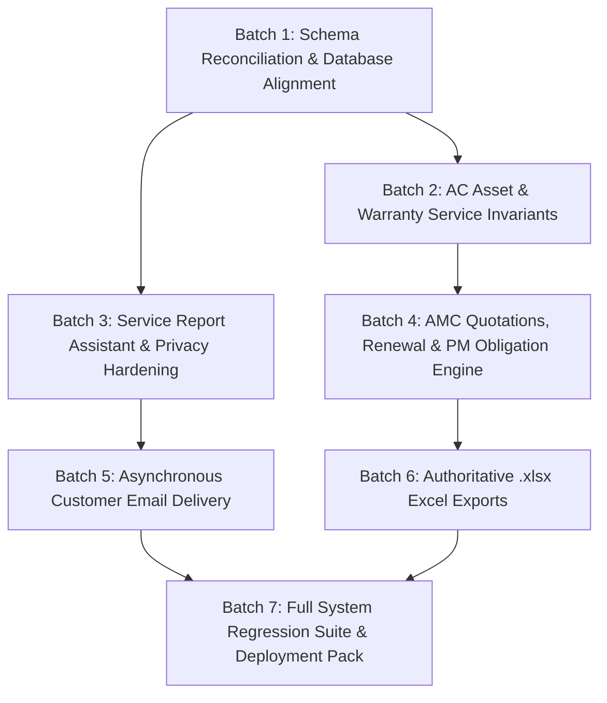

# PYS Next-Phase Execution Roadmap & Dependency Plan

**Document Version:** 1.0  
**Date:** 14 October 2026  
**Repository:** `Aayu061/place-your-service` (`main`)  
**Guiding Principle:** Strict dependency order, small testable batches, zero mock data, zero unverified assumptions.

---

## 1. Roadmap Overview & Phasing Architecture

This roadmap organizes all confirmed defects and enhancements into 6 testable execution batches ordered strictly by dependency. No higher-level feature (such as Excel exports or email dispatch) is implemented before the underlying database schemas, entity relationships, and core lifecycle state machines are stable.

---

## 2. Detailed Execution Batches

### Batch 1: Schema Reconciliation & Database Alignment (Blocker Elimination)
- **Goal:** Eliminate live database schema drift and provide missing columns required by upcoming features.
- **Tasks & Delivery:**
  1. **Warranty Services Migration:** `supabase/migrations/20261014000000_ac_asset_warranty_services.sql` inspected, and non-negative constraints along with allocation check invariant (`total = dry + jet + pumpdown`) validated against the PostgreSQL 17 engine via an isolated transactional rollback execution.
  2. **Assistant Name Migration:** Authored `supabase/migrations/20261014010000_service_schedule_and_report_assistant_name.sql`:
     - Adds `assistant_name TEXT NULL` to `public.service_schedules`.
     - Adds `assistant_name TEXT NULL` to `public.service_reports`.
     - Validated against the PostgreSQL 17 engine via isolated transactional rollback execution.
  3. **Backend & Frontend Code Alignment:**
     - Updated types (`server/src/types/index.ts`, `src/domain/types.ts`).
     - Updated validators (`schedule.validator.ts`, `serviceReport.validator.ts`).
     - Updated service persistence (`schedule.service.ts`, `serviceReport.service.ts`).
     - Added regression test suite (`server/tests/assistantNameValidation.test.ts`, 7 tests passing).
- **Validation:** Transaction-isolated rollback test on PostgreSQL 17 engine confirmed constraint enforcement and column addition. Production database preserved without unapproved modifications. Production Migration Plan generated.
- **Status:** **DEVELOPMENT & REGRESSION SUITE COMPLETE — PENDING PRODUCTION MIGRATION**

---

### Batch 2: AC Asset Refrigerant Cascade & Warranty Service Entry (COMPLETED)
- **Goal:** Fix Defect C1 (refrigerant autofill & manual override) and Defect C2 (warranty service registration).
- **Status:** **COMPLETE in Application Code & Tests** (Production live database migration `20261014000000_ac_asset_warranty_services.sql` remains queued as a production hold blocker).
- **Completed Deliverables:**
  1. **Refrigerant Cascade:** In `CustomerManagement.tsx`, `AcMasterManagement.tsx`, and `asset.service.ts`:
     - Clean cascade: Variant refrigerant → Model refrigerant → Manual entry when neither supplies a value.
     - Removed hardcoded `'R32'` defaults from state and dialog handlers in `AcMasterManagement.tsx`.
     - Deliberate manual overrides preserved during unrelated field updates.
     - Dependent values cleanly cleared/updated when model or brand changes.
  2. **Warranty Service Registration:**
     - Enforced non-negative integer and allocation invariant (`total = dry + jet + pumpdown`) across frontend validation, backend Zod validators, service layer defensive checks, and PostgreSQL constraints.
     - Frontend parses counts via `parseWarrantyCount` to catch decimals/negatives without losing entered data.
     - `createAcAsset` and `updateAcAsset` persist all 4 visit counts to database columns and map to response.
- **Tests Added & Verified:**
  - `src/tests/technologyAndAssetRegistration.test.tsx`: verified refrigerant cascade, model fallback, manual override preservation, model clearing, and warranty allocation validation with in-form reconciliation feedback.
  - `server/tests/assetPersistence.test.ts`: verified tests 4 through 10 covering refrigerant cascade precedence, model fallback, manual override, null fallback, warranty column persistence, and invalid allocation rejection (422).
  - Both frontend (173 tests) and backend (275 tests) test suites pass; production builds clean.

---

### Batch 3: Service Report Assistant Name & Privacy Hardening
- **Status:** **COMPLETED IN APPLICATION CODE & TESTS (Pending Production Migration Deployment)**
- **Goal:** Fix Defect A2 (remove technician phone from customer views) and Defect A3 (technician and assistant names).
- **Completed Deliverables:**
  1. **Assistant Name Capture & Persistence:**
     - Added `#assistant-name-input` to `ServiceVisitReportModal.tsx` prefilled from schedule, allowing staff editing.
     - Displayed assigned technician name clearly and separately from assistant name.
     - Added `assistantName?: string | null` to `UpdateServiceReportPayload` in `src/domain/types.ts`.
     - Persisted `assistant_name` in `serviceReport.service.ts` for both report creation and updates.
     - Handled blank or absent assistant names safely without inventing placeholder values.
     - Rendered separated technician and assistant names across `ServiceReportsManagement.tsx` (table and drawer) and `ServiceReportPrintView.tsx` (attribution and signatures).
  2. **Technician Phone Privacy Hardening:**
     - Removed `technicianPhone` completely from customer-facing report detail drawer in `ServiceReportsManagement.tsx` and printable receipt `ServiceReportPrintView.tsx`.
     - Hardened backend privacy by omitting `phone` from Supabase join queries (`technicians (id, name, technician_code)`) and mapping `technicianPhone: null` in `serviceReport.service.ts`.
     - Strictly retained technician contact phone in internal `TechnicianManagement.tsx` (table and profile drawer) and authoritative `technicians` table.
- **Tests Added & Verified:**
  - `src/tests/serviceReports.test.tsx` (tests 27, 28, 29, 30): Verified assistant name prefill, edit, persistence, blank handling, separated name rendering, and complete absence of technician phone from report drawer and print view.
  - `src/tests/technicians.test.tsx` (test 9): Verified technician phone access is retained in internal technician management table and detail drawer.
  - `server/tests/serviceReportRoutes.test.ts` (tests 22, 23): Verified assistant name mapping, persistence, blank safety, and `technicianPhone: null` redaction.
  - Full test suites pass: 18/18 frontend test files (178 tests) and 24/24 backend test files (277 tests); both frontend and backend builds clean.

---

### Batch 4: AMC Quotations, Renewal & Idempotent PM Generation Engine
- **Status:** **COMPLETED IN APPLICATION CODE & TESTS**
- **Goal:** Fix Defect D1 (renewal duplicate PMs), Defect D2 (draft-to-active PM generation), and Defect D3 (breakdown visit preservation).
- **Completed Deliverables:**
  1. **Draft AMC Activation:** In `amc.service.ts` `updateStatus`, transitioning from `DRAFT` to `ACTIVE` invokes `generatePmObligations`. If generation fails, contract status is atomically reverted to `DRAFT` to prevent partial activation state.
  2. **Renewal Breakdown Preservation & Overrides:** In `renewContract`, predecessor breakdown counts (`dry_service_visits`, `jet_service_visits`, `pumpdown_service_visits`) are inherited by default. Explicit valid overrides are supported and validated (`dry + jet + pumpdown === totalVisits`).
  3. **Predecessor Schedule Supersession:** In `renewContract`, unperformed predecessor schedules (`SCHEDULED`, `PLANNED`, `DUE`, `OVERDUE`) are safely marked `status = 'CANCELLED'` with `cancellation_reason = 'SUPERSEDED_BY_RENEWAL'`, while completed visits (`COMPLETED`), in-progress visits (`IN_PROGRESS`), and service reports remain strictly preserved.
  4. **Stable PM Identity & Duplicate Prevention:** Upgraded obligation generation from fragile date-only matching to composite entity identity `(amc_id, asset_id, visit_number)` and date, with graceful handling of PostgreSQL unique constraint collision (`23505`) for concurrent request safety.
  5. **Frontend Renewal Allocation UI:** Added PM Service Allocation controls (Dry, Jet, Pumpdown) to renewal modal in `AmcManagement.tsx` with live reconciliation feedback against `totalVisits`.
- **Tests Added & Verified:**
  - `server/tests/amcBatch4Fixes.test.ts`: 16 comprehensive regression test scenarios covering all Batch 4 requirements (draft activation, obligation generation, idempotency, failure rollback, non-regeneration on active updates, breakdown inheritance, explicit overrides, invalid breakdown rejection, schedule supersession, completed visit preservation, in-progress handling, per-asset traceability, concurrent duplicate collision handling, follow-up schedule isolation, and audit logging).
  - `server/tests/amcRoutes.test.ts`: 28 tests passing cleanly.
  - `src/tests/amc.test.tsx`: 13 frontend tests passing cleanly.
  - Full test suites pass: 18/18 frontend test files (178 tests) and 25/25 backend test files (293 tests); both frontend and backend builds clean.

---

### Batch 5: Asynchronous Customer Email Delivery
- **Goal:** Fix Defect A1 (automatic customer service report email delivery).
- **Tasks:**
  1. **Authoritative Email Retrieval:** Update `serviceReport.service.ts` `getReportById` to join `customers (id, name, customer_code, phone, email)`.
  2. **Email Service Implementation:** Create `server/src/services/email.service.ts`:
     - Clean interface `sendServiceReportEmail(reportId: string, recipientEmail: string, reportData: any)`.
     - Support pluggable transports: Development/Console logger transport, SMTP / Resend provider in production.
  3. **Transactional Decoupling:** In `createReport`, enqueue email dispatch in a non-blocking `setImmediate` block after database transaction commits:
     - If email succeeds: log in `activity_logs`.
     - If email fails: log warning in `activity_logs`, record delivery failure, **do not roll back the completed report**.
- **Tests to Add / Run:**
  - `serviceReport.service.test.ts`: verify email is enqueued with customer email and service report data.

---

### Batch 6: Authoritative `.xlsx` Excel Exports
- **Goal:** Fix Defect B1 (missing `.xlsx` exports for customers, schedules, reports, AMC expiry).
- **Tasks:**
  1. **Install Library:** Add `exceljs` to `server/package.json`.
  2. **Backend Export Service:** Create `server/src/services/export.service.ts`:
     - `exportCustomersToExcel()`: Customer code, name, type, phone, email, primary site, active assets count.
     - `exportServiceSchedulesToExcel()`: Schedule number, customer, site, asset tag, technician, scheduled date, service type, status.
     - `exportServiceReportsToExcel()`: Report number, schedule number, customer, technician, assistant, service date, outcome, resolution.
     - `exportAmcExpiryToExcel()`: Contract number, customer, plan, start date, end date, status, days to expiry.
  3. **Export Endpoints:** Mount authenticated endpoints in Express:
     - `GET /api/v1/customers/export`
     - `GET /api/v1/service-schedules/export`
     - `GET /api/v1/service-reports/export`
     - `GET /api/v1/amc-contracts/export/expiry`
  4. **Frontend Export Triggers:** Add "Export Excel" buttons in `CustomerManagement`, `ServiceScheduleManagement`, `ServiceReportsManagement`, and `AmcManagement`.
- **Tests to Add / Run:**
  - Unit and integration tests asserting `.xlsx` response headers and worksheet row structures.

---

### Batch 7: Full System Regression Suite & Production Deployment Pack
- **Goal:** End-to-end verification and documentation of operational readiness.
- **Tasks:**
  1. Run complete frontend Vitest suite (18+ files) and backend Jest/Vitest suite (23+ files).
  2. Verify production build output for Vite and Express.
  3. Generate `DOCS/PYS_IMPLEMENTATION_COMPLETION_REPORT.md` documenting all diffs, commit SHA, and production migration steps.
