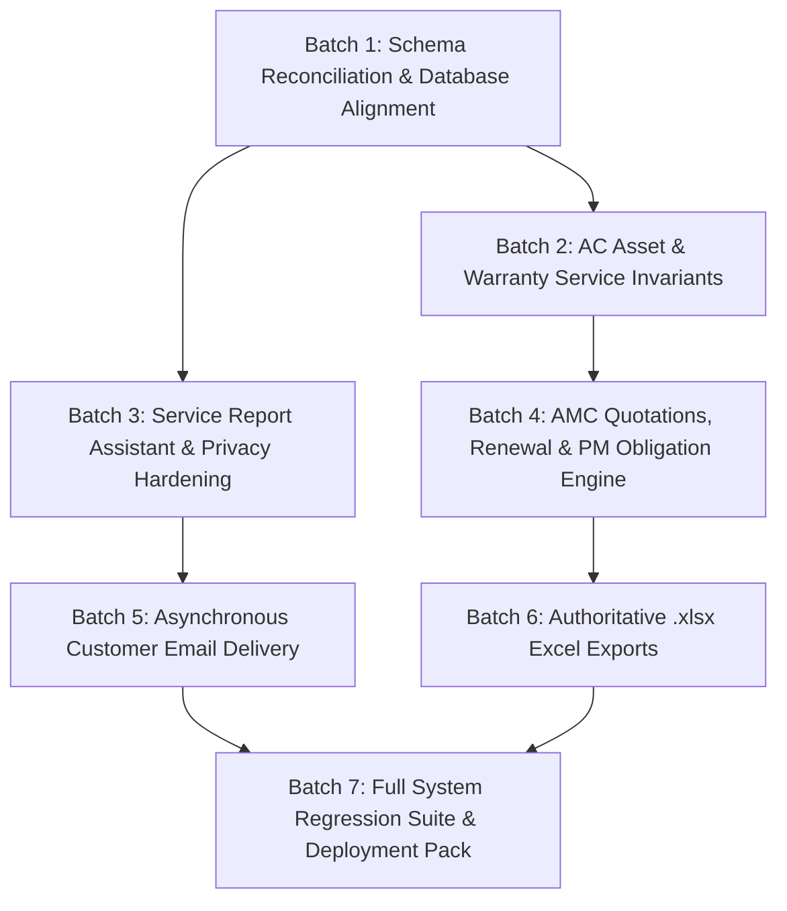

# PYS Next-Phase Execution Roadmap & Dependency Plan

**Document Version:** 1.0  
**Date:** 14 October 2026  
**Repository:** `Aayu061/place-your-service` (`main`)  
**Guiding Principle:** Strict dependency order, small testable batches, zero mock data, zero unverified assumptions.

---

## 1. Roadmap Overview & Phasing Architecture

This roadmap organizes all confirmed defects and enhancements into 6 testable execution batches ordered strictly by dependency. No higher-level feature (such as Excel exports or email dispatch) is implemented before the underlying database schemas, entity relationships, and core lifecycle state machines are stable.

---

## 2. Detailed Execution Batches

### Batch 1: Schema Reconciliation & Database Alignment (Blocker Elimination)
- **Goal:** Eliminate live database schema drift and provide missing columns required by upcoming features.
- **Tasks & Delivery:**
  1. **Warranty Services Migration:** `supabase/migrations/20261014000000_ac_asset_warranty_services.sql` inspected, and non-negative constraints along with allocation check invariant (`total = dry + jet + pumpdown`) validated against the PostgreSQL 17 engine via an isolated transactional rollback execution.
  2. **Assistant Name Migration:** Authored `supabase/migrations/20261014010000_service_schedule_and_report_assistant_name.sql`:
     - Adds `assistant_name TEXT NULL` to `public.service_schedules`.
     - Adds `assistant_name TEXT NULL` to `public.service_reports`.
     - Validated against the PostgreSQL 17 engine via isolated transactional rollback execution.
  3. **Backend & Frontend Code Alignment:**
     - Updated types (`server/src/types/index.ts`, `src/domain/types.ts`).
     - Updated validators (`schedule.validator.ts`, `serviceReport.validator.ts`).
     - Updated service persistence (`schedule.service.ts`, `serviceReport.service.ts`).
     - Added regression test suite (`server/tests/assistantNameValidation.test.ts`, 7 tests passing).
- **Validation:** Transaction-isolated rollback test on PostgreSQL 17 engine confirmed constraint enforcement and column addition. Production database preserved without unapproved modifications. Production Migration Plan generated.
- **Status:** **DEVELOPMENT & REGRESSION SUITE COMPLETE — PENDING PRODUCTION MIGRATION**

---

### Batch 2: AC Asset Refrigerant Cascade & Warranty Service Entry
- **Goal:** Fix Defect C1 (refrigerant autofill & manual override) and Defect C2 (warranty service registration).
- **Tasks:**
  1. **Refrigerant Cascade:** In `CustomerManagement.tsx` and `asset.service.ts`:
     - When a model is chosen, default to `model.refrigerant` if variant refrigerant is null.
     - Allow free manual override without reverting.
     - Remove hardcoded `'R32'` fallback from `AcMasterManagement.tsx` dialog openers.
  2. **Warranty Service Registration:**
     - Ensure `createAcAsset` writes `total_warranty_services`, `dry_warranty_visits`, `jet_warranty_visits`, `pumpdown_warranty_visits` to `public.ac_assets`.
     - Validate frontend and backend schema validation rejects negative numbers or mismatched sums.
- **Tests to Add / Run:**
  - `assetSpecificationFlow.test.tsx`: test refrigerant selection and manual override.
  - `asset.service.test.ts`: test asset creation with complete warranty breakdown.

---

### Batch 3: Service Report Assistant Name & Privacy Hardening
- **Goal:** Fix Defect A2 (remove technician phone from customer views) and Defect A3 (technician and assistant names).
- **Tasks:**
  1. **Schema & Typings:** Add `assistantName?: string` to `ServiceSchedule` and `ServiceReport` interfaces (frontend and backend).
  2. **Service Report Modal:** Update `ServiceVisitReportModal.tsx` to display assigned technician and assistant name input (prefilled from schedule).
  3. **Display & Print Views:**
     - Update `ServiceReportsManagement.tsx` and `ServiceReportPrintView.tsx` to render both technician and assistant names.
     - **Remove `technicianPhone`** from `ServiceReportsManagement.tsx` drawer, report table, and printable receipt.
- **Tests to Add / Run:**
  - `serviceVisitReportModal.test.tsx`: assert assistant name input presence and prefill.
  - `serviceReportsManagement.test.tsx`: assert technician phone is absent from DOM.

---

### Batch 4: AMC Quotations, Renewal & Idempotent PM Generation Engine
- **Goal:** Fix Defect D1 (renewal duplicate PMs), Defect D2 (draft-to-active PM generation), and Defect D3 (breakdown visit preservation).
- **Tasks:**
  1. **Draft Activation:** In `amc.service.ts` `updateStatus`, when transitioning to `'ACTIVE'`, call `generatePmObligations`.
  2. **Renewal Preservation:** In `renewContract`, copy predecessor breakdown visits (`dry_service_visits`, `jet_service_visits`, `pumpdown_service_visits`) if not explicitly overridden.
  3. **Cancel Superseded Visits:** In `renewContract`, mark any unperformed predecessor schedules (`SCHEDULED` or `PLANNED`) as `status = 'CANCELLED'` with reason `'SUPERSEDED_BY_RENEWAL'`.
  4. **Deterministic Obligation Keys:** Harden `pm_obligation_id` to prevent duplicate schedule rows for the same contract, asset, and visit number.
- **Tests to Add / Run:**
  - `amc.service.test.ts`: verify draft activation triggers PM generation.
  - `amcAllocationPlanner.test.ts`: verify renewal inherits breakdown counts and cancels superseded schedules without duplicating.

---

### Batch 5: Asynchronous Customer Email Delivery
- **Goal:** Fix Defect A1 (automatic customer service report email delivery).
- **Tasks:**
  1. **Authoritative Email Retrieval:** Update `serviceReport.service.ts` `getReportById` to join `customers (id, name, customer_code, phone, email)`.
  2. **Email Service Implementation:** Create `server/src/services/email.service.ts`:
     - Clean interface `sendServiceReportEmail(reportId: string, recipientEmail: string, reportData: any)`.
     - Support pluggable transports: Development/Console logger transport, SMTP / Resend provider in production.
  3. **Transactional Decoupling:** In `createReport`, enqueue email dispatch in a non-blocking `setImmediate` block after database transaction commits:
     - If email succeeds: log in `activity_logs`.
     - If email fails: log warning in `activity_logs`, record delivery failure, **do not roll back the completed report**.
- **Tests to Add / Run:**
  - `serviceReport.service.test.ts`: verify email is enqueued with customer email and service report data.

---

### Batch 6: Authoritative `.xlsx` Excel Exports
- **Goal:** Fix Defect B1 (missing `.xlsx` exports for customers, schedules, reports, AMC expiry).
- **Tasks:**
  1. **Install Library:** Add `exceljs` to `server/package.json`.
  2. **Backend Export Service:** Create `server/src/services/export.service.ts`:
     - `exportCustomersToExcel()`: Customer code, name, type, phone, email, primary site, active assets count.
     - `exportServiceSchedulesToExcel()`: Schedule number, customer, site, asset tag, technician, scheduled date, service type, status.
     - `exportServiceReportsToExcel()`: Report number, schedule number, customer, technician, assistant, service date, outcome, resolution.
     - `exportAmcExpiryToExcel()`: Contract number, customer, plan, start date, end date, status, days to expiry.
  3. **Export Endpoints:** Mount authenticated endpoints in Express:
     - `GET /api/v1/customers/export`
     - `GET /api/v1/service-schedules/export`
     - `GET /api/v1/service-reports/export`
     - `GET /api/v1/amc-contracts/export/expiry`
  4. **Frontend Export Triggers:** Add "Export Excel" buttons in `CustomerManagement`, `ServiceScheduleManagement`, `ServiceReportsManagement`, and `AmcManagement`.
- **Tests to Add / Run:**
  - Unit and integration tests asserting `.xlsx` response headers and worksheet row structures.

---

### Batch 7: Full System Regression Suite & Production Deployment Pack
- **Goal:** End-to-end verification and documentation of operational readiness.
- **Tasks:**
  1. Run complete frontend Vitest suite (18+ files) and backend Jest/Vitest suite (23+ files).
  2. Verify production build output for Vite and Express.
  3. Generate `DOCS/PYS_IMPLEMENTATION_COMPLETION_REPORT.md` documenting all diffs, commit SHA, and production migration steps.
